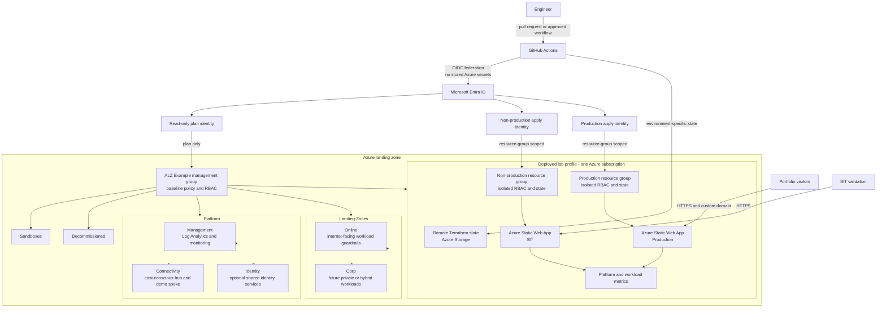

# Azure Enterprise Landing Zone Reference Implementation

This project will demonstrate how to design, deploy, and operate a production-minded Azure landing zone for a fictional medium-sized organization. The platform will be intentionally cost-conscious so that it can be evaluated and, where practical, deployed from a personal Azure account.

After the platform foundation is validated, an existing personal website will be onboarded as the first governed workload. This proves that the landing zone is usable, rather than only presenting a theoretical architecture.

## Project status

Architecture decisions 0001–0008 are accepted. The lab profile is deployed in Azure with remote state, management groups, policy, group-based RBAC, monitoring, cost-conscious hub-and-spoke networking, and GitHub OIDC identities. The first governed workload is live in Azure Static Web Apps with isolated non-production and production delivery, custom domains, managed TLS, and privacy-safe demonstration data.

## Architecture

The repository models an enterprise target while deploying a cost-conscious single-subscription lab. Management groups express governance archetypes; subscriptions provide the intended enterprise isolation boundary; and the lab uses separate resource groups, identities, state files, and GitHub environments to demonstrate the same operating model without overstating its isolation.

The enterprise profile places Management, Connectivity, web-portfolio production, and web-portfolio non-production in separate subscriptions beneath their respective management groups. The deployed lab intentionally consolidates those resources into one Azure Free Trial subscription while preserving logical and authorization boundaries.

## Planned outcomes

- A documented enterprise scenario and set of architectural assumptions
- Management-group and subscription organization
- Identity and privileged-access design
- Policy-driven governance and security guardrails
- A cost-conscious connectivity model
- Central monitoring, security, and audit design
- Repeatable infrastructure-as-code deployment
- Automated validation and safe cleanup guidance
- Architecture diagrams and decision records
- Onboarding of one existing website into production and non-production environments

## Guiding principles

- Use production patterns while keeping expensive services optional.
- Prefer enforceable controls and automated tests over screenshots.
- Record important tradeoffs in architecture decision records.
- Keep credentials, tenant identifiers, subscription identifiers, and personal information out of source control.
- Make deployment and teardown safe, documented, and repeatable.

## Repository map

| Path | Purpose |
|---|---|
| `bootstrap/terraform-state` | Creates and migrates the Azure Storage backend |
| `modules` | Reusable, environment-neutral Terraform modules |
| `platform/organization` | Management groups, policy, and organization-level RBAC |
| `platform/management` | Central monitoring and management resources |
| `platform/connectivity` | Hub, demo spoke, peering, and shared network services |
| `workload-foundations` | Platform-owned resource groups and application onboarding RBAC |
| `tests` | Static, policy, repository, and opt-in integration validation |

## Local prerequisites

- Terraform 1.16.5
- Azure CLI for authenticated plans and deployments
- TFLint 0.59.1 for local linting

Pull requests run formatting, offline initialization, validation, Terraform tests, linting, and secret scanning without Azure credentials. A manual Azure-backed plan workflow uses a read-only OIDC identity for the organization, management, and connectivity roots. Apply automation remains intentionally disabled until its write-capable identity and protected GitHub environment receive explicit approval.

See [the project brief](docs/project-brief.md), [decision review record](docs/decision-review.md), [architecture decision index](docs/decisions/README.md), [Wedding onboarding design](docs/workloads/wedding-onboarding.md), and [state-bootstrap runbook](bootstrap/terraform-state/README.md).
